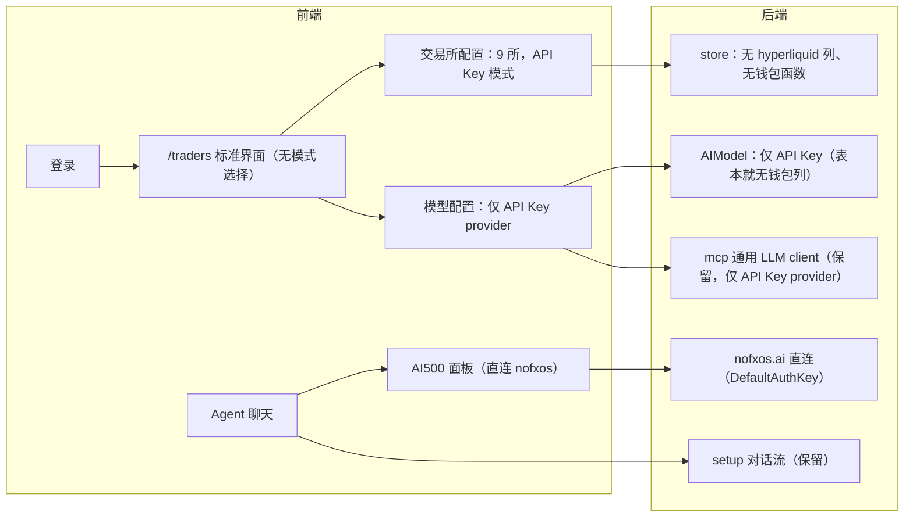

# 技术设计（父任务）：移除 Hyperliquid 与 claw402 钱包体系

本文件只承载跨子任务的技术决策与终态契约；各子任务的逐文件删除清单见其 implement.md。所有行号基于 main@3b6831eb。

## 1. 终态架构



- **交易所层**：9 所，凭证统一 `apiKey/secretKey(/passphrase)`（okx/bitget/kucoin 带 passphrase；aster 三元组、lighter 钱包字段为其 API Key 模式的自身形态，不属于本次删除的 EVM 私钥连接体系）
- **模型层**：仅 API Key provider；钱包付费（claw402/blockrun-base/blockrun-sol）与 x402 支付轨道全删
- **入口**：登录后恒 `/traders`；无 `/welcome`、无模式持久化（localStorage 键一并清除；`/setup` 路由对已登录用户的重定向改指 `/traders`）
- **AI500**：`ResolveClient` 收敛为恒直连 `nofxos.ai`

## 2. 跨切面技术决策

| # | 决策 | 依据 |
|---|------|------|
| 1 | blockrun-base / blockrun-sol 随 D6 删除 | 二者仅存在于目录/枚举/校验（`agent/model_provider_catalog.go:44,54`、`config_validation.go:26`、`handler_ai_model.go:250-251`），无独立运行时轨道；D6 语义是钱包付费 provider 体系整体消失 |
| 2 | AI500 保留，走直连 | `client_resolve.go:19-21` 无钱包 key 时回退直连 + `client.go:17,19` DefaultBaseURL/DefaultAuthKey；删除 claw402 分支后直连成为唯一路径，实证不依赖 claw402 代码 |
| 3 | AICharge 表与通用统计保留，删两个专属函数 | ai_charges 表无钱包字段、全模型通用；`IsClaw402Config`（:152-155）、`EstimateRunway`（:157-169）是 claw402 专属，调用点 `auto_trader.go:650,675`、`auto_trader_loop.go:34,745` 随 C2 删 |
| 4 | 聊天 setup 流保留 | `agent/onboard.go` 无 beginner/wallet/claw402 分支（实证）；仅删其中的 hyperliquid 分支（C1），钱包 provider 引导文案归 C2 |
| 5 | `kernel.NewStrategyEngine` 签名收敛 | 当前为 variadic `claw402WalletKey ...string`（`kernel/engine.go:192`）；带参调用仅两处：`api/strategy.go:582`、`trader/auto_trader.go:368`，收敛时这两处同步；`engine.go:206-209` 的 `CLAW402_WALLET_KEY/URL` env 读取一并删 |
| 6 | `wallet/` 整包删除 | 包内仅 `usdc.go` + `balance_cache.go`；7 个消费方（handler_ai_model、auto_trader_loop、handler_onboarding、handler_wallet、auto_trader、mcp/payment/claw402、agent.go）全部在 C2 清单内；**`trader/auto_trader.go` 必须先编辑完，整删才成立** |
| 7 | `mcp/` 整包保留，仅删支付轨道 | mcp 是通用 LLM client 库（21 个文件 + provider/ 注册 8 个 API Key provider + intro/），`rg -ln "nofx/mcp"` 命中 38 个文件。删除物：`mcp/payment/` 整子包（claw402.go、x402.go）、`providers.go:16` 的 `ProviderClaw402` 常量、`client.go:59-66` `TokenUsage.Channel()` 的 claw402 分支、`main.go:12`/`telegram/bot.go:8`/`api/strategy.go:11`/`trader/auto_trader.go:9` 的 blank import |
| 8 | AIModel store 层删函数、DTO 删字段 | `store/ai_model.go` 的 AIModel 无钱包列（表从未有）；删 `ResolveClaw402WalletKey`（:299）、`FindOrphanClaw402`（:58）、`AdoptModel`（:70）与"recover wallets"机制；DTO 的 `WalletAddress/BalanceUSDC` 在 `agent/tools.go:993-994`、`api/handler_ai_model.go:37-38` 删 |
| 9 | 模型枚举双源同步删 | 除 catalog 外，`api/handler_ai_model.go:241-253` `handleGetSupportedModels` 有一份独立硬编码列表（含 claw402/blockrun 三条及默认模型），必须同步，否则 /supported-models 仍暴露已删 provider |
| 10 | 凭证签名一次性收敛 | `MissingRequiredExchangeCredentialFields` 定义于 `store/visibility.go:5`（三 hyperliquid 参数），`ExchangeStore.Create`/`.Update`（exchange.go:241,292）与全部调用点同步，不留重载兼容 |
| 11 | SourceType 枚举收窄 | `store/strategy.go` 删 `hyper_all/hyper_main/hyper_rank`（CoinSource 6 字段 :774-785、normalize case :178-223、normalizeCoinSourceType :260-265、inferCoinSourceType :283-290）；**default 分支重定向 `static`**；`GetDefaultStrategyConfig`（:909）默认 SourceType 改 `static`、RoleDefinition（:986-1008）换通用 crypto 文案；`HyperMainLimit` 等残余字段（:1462-1467）删 |
| 12 | 预置美股策略删除 | `api/handler_user.go:223-299` createDefaultStrategies 的 3 个美股 USDC 预置策略是 xyz 板产品功能，随 D2 删；新用户初始无预置策略 |
| 13 | `/wallet/validate`、`/wallet/generate` 删除 | EVM 私钥校验/生成 + USDC 余额仅服务 Hyperliquid 私钥模式与 claw402 钱包创建，两大消费方均删 |
| 14 | `docker-compose.yml` 删钱包环境持久化 | :14-20 的 `.env` bind mount 注释块与 persistBeginnerWalletEnv 说明删除（persistBeginnerWalletEnv 本体在 handler_onboarding.go:241-270 随文件删）；`env_file: .env`（:23-24）是通用配置，保留。`.nofx-local/compose.yml` 已核实无 CLAW402 引用，无需改动 |
| 15 | telemetry Channel 链清理 | `telemetry/experience.go:45` Channel 字段注释 ← `config/config.go:164` `usage.Channel()` ← `mcp/client.go:59-66`，随 mcp 分支删除同步收敛 |
| 16 | `/api/symbols` 以 Gate 重接（D7） | 现状仅 hyperliquid 三 case（:472-532，default 400），删除后空壳。新增 `case "gate"`：`provider/gate/symbols.go` 用 gateapi-go 公开客户端（无 key）拉 `GET /futures/usdt/contracts` + `GET /futures/usdt/tickers`（Gate API v4 公开行情，免鉴权），映射 SymbolInfo（contract→symbol、last/mark_price→MarkPrice、volume_24h_settle→Volume24h、24h 涨跌幅→Change24hPct、leverage_max→MaxLeverage、order_size_min→SzDecimals；过滤 in_delisting；字段名以 SDK FuturesContract/FuturesTicker 为准）；`DefaultQuery` 默认改 `gate`；`hyperliquidCategoryOrder` 排序退化为 crypto 单类按 Volume24h 降序 |
| 17 | 默认交易所全局收敛为 gate（D7） | `/api/klines` 默认值（handler_klines.go:33，现 binance）改 gate；前端 ChartTabs :49（现 hyperliquid）、TraderDashboardPage :60（现 binance）改 gate；9 所功能平权不变，仅默认值偏向 |

## 3. 契约变化（终态 API 面）

| 契约 | 终态 |
|------|------|
| `GET /api/symbols?exchange=` | 默认 exchange=gate（D7）；实现 gate（USDT 永续合约清单，Gate 公开接口）；无 hyperliquid / hyperliquid-xyz / xyz；其余交易所暂 400（Unsupported exchange） |
| `GET /api/klines?exchange=` | 默认 exchange=gate（原 binance）；gate K 线沿用 coinank 数据链路（`market/data_klines.go:65` 已有映射） |
| `POST/PUT /api/exchanges` | 请求体无 `hyperliquidWalletAddr` / `hyperliquidUnifiedAccount` / `hyperliquidBuilderApproved` |
| `/hyperliquid/*`、`/wallet/*`、`/onboarding/beginner*` | 路由消失（404） |
| 模型 provider 枚举（catalog、handleGetSupportedModels、agent 工具 schema、skills JSON、前端 model-constants） | 仅 API Key provider |
| AIModel 对象 | 无钱包地址/余额 DTO 字段 |
| 策略 SourceType | `static / ai500 / oi_top / oi_low`，default 与建策略默认值为 static |
| `kernel.NewStrategyEngine` | 单参数（内部 API） |
| server.go 路由文档注释 | 交易所枚举 9 所（CEX 7 + DEX 2：aster/lighter） |

## 4. 数据重置（D3）

`.nofx-local/compose.yml`：`DB_TYPE: sqlite`、`DB_PATH: /app/data/data.db`、卷挂载 `./candidate-data:/app/data`，journal_mode=delete（冷拷贝即一致）。

1. 停容器；`cp candidate-data/data.db scratch/data.db.bak` 全量备份
2. 用 sqlite3 CLI：保留 `users` 表与登录行，drop 其余全部表（users 表实测仅 id/email/password_hash/created_at/updated_at 五列，无模式/钱包列，无脏列风险）
3. 启动终态镜像，GORM AutoMigrate（`store/store.go:118-167`）以终态 schema 重建被 drop 的表（exchanges 现存 hyperliquid 三列随重建消失）
4. 验证：旧账密可登录，交易所/模型/策略/trader 均为空态

**禁用 `nofx reset-account`**（`cli.go:169-178`）：它连 users 一起删（违反 D3）、只清 5 张表漏掉 ai_charges/grid_*/trader_orders 等 12 张、不清 exchanges 旧列。

重置中间产物（表清单、DB 备份）放 gitignore 的 `scratch/`。不做兼容迁移脚本。

## 5. 风险与对策

| 风险 | 对策 |
|------|------|
| C5 镜像构建来源错误（compose 无 build 段、引用旧 tag 961e016d；从 preview/source worktree 构建会拿上游旧代码"通过"验收） | C5 钉死构建步骤：C4 终态 commit 的仓库根 `docker build -f docker/Dockerfile.*`，更新 compose image tag，并以运行时探针三件套验证部署物 |
| SourceType default 塌缩：删 hyper_rank 后 normalize/infer 的 default 分支静默改写策略行为 | default 显式重定向 static 并加测试；C1 内完成（C5 才重置数据，中间窗口靠重定向保底） |
| i18n 删键产生孤儿引用 | 删键时全局 grep 键名；TS 构建兜底 |
| wallet/mcp 包删除波及策略引擎与全部 API Key provider 编译 | mcp 整包保留仅删支付轨道；C2 内 NewStrategyEngine 签名收敛与 auto_trader.go 编辑先于 wallet 整删，build 即时暴露 |
| auto_trader 运行时分支误伤其余 9 所 | 仅删目标 case，工厂注册表逐项核对；go test 覆盖 |
| 前端 xyz 图表残留空数据崩溃 | ChartTabs 无 exchangeId 的默认值改 9 所首项；以 BTC/ETH 常规标的图表冒烟 |
| `.env` 残留 `CLAW402_WALLET_*`（persistBeginnerWalletEnv 曾回写） | client_resolve 收敛恒直连后 env 变惰性；C5 运维步骤中清掉宿主机 `.env` 的 CLAW402_* 三变量 |
| 数据重置后登录失效 | 重置前 `cp` 全量备份到 scratch，失败即整文件恢复 |
| Gate e2e 真实资金风险 | 最小张数 BTC_USDT 市价单（`trader_orders.go:64-68` size<1 张自动取 1），成交后立即 ReduceOnly 全量平仓；只读验证先行；余额以 available 为基准对账 |
| Gate 公开行情限频（单接口 200r/10s/IP） | provider/gate 拉取 contracts+tickers 为低频清单查询；K 线沿用 coinank 链路不经 Gate；前端轮询频率维持现状 |
| 共享文件（agent/、api/）跨子任务编辑冲突 | 子任务严格串行：C1 → C2 → C3 → C4 → C5（C4 为弱依赖，可与 C3 并行，C5 前收口） |

## 6. 回滚形态

不使用 git 回滚命令。回滚 = 手动文件级恢复：每个子任务的 implement.md 定义检查点（可编译的完整状态），每阶段结束时执行

```bash
git diff > scratch/cN-stageM.full.patch      # 全量内容 diff（--stat 无法支撑恢复，禁用为唯一存档）
git status --porcelain > scratch/cN-stageM.files.txt
```

某步失败时，以 `.full.patch` 为参照用文件编辑工具将改动文件恢复到检查点内容（deleted-file diff 含被删文件全文，可完整恢复）。子任务之间独立可重试：失败只重做当前子任务；已 commit 的子任务边界即天然恢复点。C5 的回滚 = compose image 字段改回旧 tag 再 up + DB 备份整文件恢复。

## 7. 子任务顺序与共享文件

- 执行顺序固定：C1 → C2 → C3 → C4 → C5；C4（纯文档）与 C3 无真实依赖，可并行，但必须在 C5 前完成
- 共享热点：`agent/tools.go`、`agent/skill_*_handlers.go`、`api/server.go`、`agent/skills/*.json` 同时被 C1（hyperliquid）与 C2（claw402）触碰，串行执行规避冲突
- C1/C2 的闭环为静态级（build/test/grep），系统整体运行推迟：C3 的浏览器验证以 `go run` 起临时后端（独立 DB 路径避免污染 `./data` 旧库、端口避开被占用的 8080）为准，**不中途构建镜像**；C5 才做终态镜像的部署级验证
- UI 验收分工：C3 验证前端代码终态正确（临时后端）；C5 验证部署形态（终态镜像 + 重置数据 + Gate e2e），两边都做截图，互不替代
