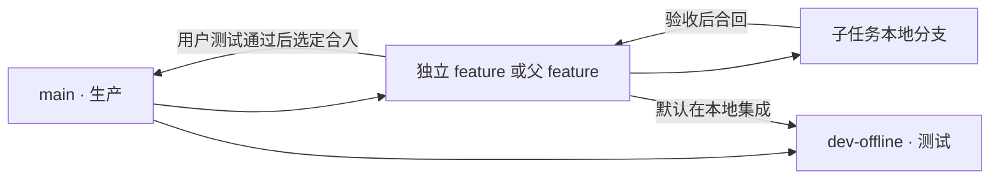

# NOFX Git 工作流

仓库以 `main` 管生产、`dev-offline` 集成测试、`feat/` 交付单一功能。Trellis 与直接开发使用同一套 Git 流程。 [AGENTS.md](../AGENTS.md)



## 开工

从主工作区核对已有 worktree，fetch 后从最新 `origin/main` 建功能分支和专属 worktree。下面的日期和 slug 按实际需求替换。

```bash
git worktree list
git fetch origin
git worktree add --no-track -b feat/2026_1119_order-history \
  ../nofx-wt/feat-2026_1119_order-history origin/main
```

在新 worktree 中核对分支和状态，再实施或写 Trellis 文档。独立 feature 与父 feature 的稳定提交推送到同名远端分支。

```bash
git push -u origin HEAD
```

Trellis 父任务在父 worktree 写入并提交需求、子任务顺序及验收。每个子任务实际开始时，确认前置子任务已完整合入父分支，再从父分支当前最新提交创建本地子分支。

```bash
git worktree add --no-track -b feat/2026_1119_order-history--api \
  ../nofx-wt/feat-2026_1119_order-history--api feat/2026_1119_order-history
```

子任务跑完完整门禁，在父 worktree 执行合并和 Trellis 归档，确认父分支包含全部子提交后移除干净的子 worktree，用 `git branch -d` 删除已合并的子分支。这一步只在本地执行。全部子任务合入后，父任务完成多智能体对抗式审查、修正及串联全任务验收，再推送最终候选。 [.trellis/workflow.md](../.trellis/workflow.md)

## 合入本地 dev-offline

首次设置时，从最新 `origin/main` 初始化 `dev-offline`，之后使用长期的 `nofx-wt/dev-offline` worktree。根 feature 验收后默认在该 worktree 集成。先获取最新引用并核对当前分支和工作区。

```bash
git fetch origin &&
  test "$(git branch --show-current)" = dev-offline &&
  test -z "$(git status --porcelain)" &&
  git merge --ff-only origin/dev-offline &&
  test "$(git rev-parse HEAD)" = "$(git rev-parse origin/dev-offline)"
```

对齐成功后依次合入此次 fetch 的 `origin/main` 和已推送的源 feature。选择已经验收的源 feature 提交。若出现冲突，在当前 worktree 编辑冲突文件、提交合并结果并验证，然后继续。

```bash
git merge --no-edit origin/main &&
  git merge --no-ff --no-edit origin/feat/2026_1119_order-history
```

本地还有待发布候选，或者与远端分叉时，保留该候选并等待用户同步。集成完成后记录源 feature SHA 和本地集成 SHA，交给用户运行。测试合并提交、冲突解决和临时集成修正都留在 `dev-offline`。

## 用户验证与发布

1. 在 `dev-offline` worktree 运行项目并确认候选可用。
2. 每次推送前执行 `git pull --no-rebase origin dev-offline`，纳入远端最新提交。若候选改变，处理冲突并重验更新后的候选，再由用户执行 `git push origin dev-offline`。
3. 用户手动将已推送的 `dev-offline` 提交部署到 Docker 测试环境。记录实际部署的提交和测试结论，并关联源 feature 提交。
4. 测试通过后，用户将选定的源 feature 合入已更新的 `main`。合并采用保留源提交祖先关系的方式，确认 `origin/main` 已包含该 feature 的全部交付提交，再清理该 feature 的本地、远端分支与 worktree。

生产 Docker 部署取 `main` 的指定提交，测试 Docker 部署取 `dev-offline` 的指定提交。使用源码构建时，从对应提交的 checkout 使用 `docker-compose.yml`。使用预构建镜像时，核对镜像仓库、源码提交和 digest。测试与生产使用各自的配置、端口、数据目录及数据库。

本地用独立测试配置，在 `dev-offline` worktree 构建并等待服务健康。同一 Docker 主机并行运行时核对宿主端口和 Compose 中的固定容器名，必要时用本地 Compose override 隔离。

```bash
docker compose -p nofx-dev-offline up -d --build --wait
docker compose -p nofx-dev-offline ps
```

GitHub Actions 按分支执行检查和构建镜像。测试与生产环境的 Docker 发布由用户触发。社区向上游仓库提交 PR 时使用上游的贡献指南。 [CONTRIBUTING.md](../CONTRIBUTING.md)
